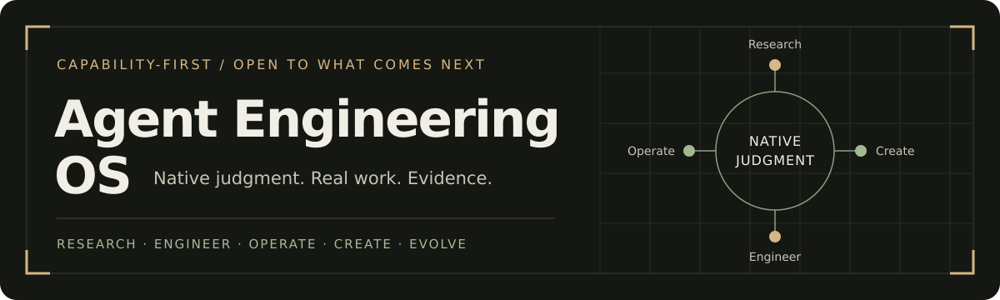

# SMART AGENT

A consolidated personal skill for adaptive engineering, creative work, research and operations with selective context, current capabilities and observable results. Formerly **Agent Engineering OS**; invoked as **`$smart-agent`**.

SMART AGENT keeps the current model's native judgment in charge. It supplies reusable domain guidance, evidence standards, a module manager and searchable pinned source libraries. It does not create tools, credentials, model access or a background process by itself.

## What this update adds

- **26 reference modules**, with a local inventory, advisory selection, enable/disable preferences and integrity diagnostics.
- **485 indexed references across 16 source registrations**, including retained libraries and the newly requested sources. An index entry is a guide, skill or workflow, not an independently installed executable tool.
- Three.js and its official site, Atlas Components, Superpowers, Agent Beacon, Headroom, PixelRAG and Open3DLab adapters.
- **Priority reverse engineering:** reverse-skill and REA, including case/evidence workflows, provider distinctions, retained dossiers and recovery boundaries.
- All 12 requested cybersecurity tools, with scoped use cases and evidence requirements, plus reverse proxy performance monitoring and troubleshooting.
- A refreshable model inventory with separate cache and execution-surface observations; future IDs can be discovered without rewriting a fixed family list.
- Token efficiency through bounded retrieval, selective references and measured comparisons. No unmeasured savings percentage is claimed.

The [English deep summary](docs/SMART-AGENT-summary-en.md) and [Arabic deep summary](docs/SMART-AGENT-summary-ar.md) explain the architecture, tools, examples, maintenance and limitations. Printable editions are available in [English](docs/SMART-AGENT-English.pdf) and [Arabic](docs/SMART-AGENT-Arabic.pdf).

## Install and migrate

The installable bundle is [smart-agent/](smart-agent/). For a supported installer, use: `Install the skill from https://github.com/AdnanNaous/smart-agent/tree/main/smart-agent`. Keep its `SKILL.md`, `agents/`, `references/`, `assets/` and `scripts/` together. Install the inner folder using your runtime's supported skill installer, or copy it to `~/.codex/skills/smart-agent/` (Windows: `%USERPROFILE%\.codex\skills\smart-agent\`). The display name is **SMART AGENT**, while the technical slug uses lowercase hyphens.

Back up an existing `agent-engineering-os` installation and personal modifications before replacing its active folder. Keep one active coordinator to avoid duplicate triggers. Historical source/runtime directory names can remain unchanged to preserve working dependencies. A repository update does not propagate automatically into another device or runtime. The current chat may retain its original skill catalog; reopen the chat or refresh skills if the new name is not yet offered.

```text
$smart-agent Fix the failing behavior in this repository and verify the affected path.
$smart-agent Build an Arabic RTL dashboard using the existing design system.
$smart-agent Diagnose reverse proxy p95 latency using the supplied logs.
$smart-agent Find appropriate Three.js guidance and assess the asset's license before import.
$smart-agent Continue from the checkpoint and reconcile it with current files.
```

## Management system

Run Python 3.10+ commands from the installed bundle, or use absolute script paths. On Windows, invoke a quoted interpreter using PowerShell's `&` operator.

```text
python scripts/manage.py list
python scripts/manage.py recommend "nginx upstream latency"
python scripts/manage.py recommend "Arabic RTL accessible dashboard"
python scripts/manage.py show web-3d
python scripts/manage.py disable visual-retrieval
python scripts/manage.py enable visual-retrieval
python scripts/manage.py doctor
python scripts/toolkit.py search "systematic debugging" --source superpowers --limit 5
python scripts/toolkit.py read "superpowers:skills/systematic-debugging/SKILL.md"
python scripts/toolkit.py check
```

The registry is [modules.json](smart-agent/assets/modules.json). Recommendations are bounded lexical hints, not a new reasoning engine. Enablement changes this skill's suggestions only; it never disables safety/authorization requirements or installs/uninstalls tools. User instructions take precedence. Preferences are stored outside the bundle at `${CODEX_HOME}/skill-state/smart-agent/modules.json`; the default Codex home is `~/.codex`. `SMART_AGENT_STATE` isolates test state.

`doctor` checks module paths and source presence. `toolkit.py check` checks exact revisions, indexed file hashes and recorded notices. Missing optional dependencies are explicit limitations. An absent historical Blender download is reported as a warning; it is not claimed as verified. Source presence does not establish authenticated services, working graphics or a successful penetration test.

## Integrated sources

| Source | Useful contribution | Current integration boundary |
| --- | --- | --- |
| [Three.js source](https://github.com/mrdoob/three.js) and [official site](https://threejs.org/) | Browser 3D, scene lifecycle, loaders, performance, WebGL/WebGPU decisions | Pinned guides and adapter; no sample application or renderer was installed by this update |
| [Agent Beacon](https://github.com/Asymptote-Labs/agent-beacon) | Session evidence, replay and reusable knowledge | Reference only; no session collector, cloud connection or memory writer activated |
| [Atlas Components](https://github.com/TurkiHassan/atlas-components) | React/TypeScript component selection and Arabic RTL examples | Reference only; reviewed package is locally packed. Repository-level redistribution rights require review |
| [Superpowers](https://github.com/obra/superpowers) | Debugging, focused tests, plans and evidence before completion | Selective adaptation; no compulsory global gates or automatic agent dispatch |
| [Headroom](https://github.com/headroomlabs-ai/headroom) | Context compression and retrieval ideas | Reference and measurement guidance; no proxy/wrapper/config modification activated |
| [PixelRAG](https://github.com/StarTrail-org/PixelRAG) | Rendering and retrieval of visual document evidence | Reference only; no ML model, hosted query or screenshot pipeline activated |
| [reverse-skill](https://github.com/zhaoxuya520/reverse-skill) | Scenario routing, case scope and evidence contracts | Priority reference; no bootstrap, target operation or agent dispatch activated |
| [REA](https://github.com/morluto/rea) | Application/binary analysis, CLI/MCP providers and retained evidence | Priority reference; no setup, MCP registration or native provider installation |
| [Open3DLab](https://open3dlab.com/) | User-requested external 3D asset candidate | Automated read encountered an Anubis challenge; no asset/license/download verified |

The existing UI Skills, gstack, Codex Auto Model Router, game guides, Meowa, Blender MCP and Codex Game Studio references are retained. The complete source revisions and notice checksums are recorded in [toolkit-sources.json](smart-agent/assets/toolkit-sources.json). Upstream libraries are stored outside the bundle; their hooks, installers, telemetry, model defaults and publishing prompts never become authorization merely through inclusion.

For a fresh environment, inspect the manifest first and explicitly acquire a chosen pin:

```text
python scripts/fetch_sources.py --source superpowers
python scripts/toolkit.py refresh
python scripts/toolkit.py check
```

The fetch helper rejects existing targets and acquires inert sparse documents at the exact pin without running upstream setup. `--destination` supports a reviewed alternative location; deliberately update the manifest root before index refresh. The separately installed Meowa skill and optional Blender attachment have their own prerequisites. No bulk installation is necessary for ordinary skill use.

## Cybersecurity and reverse proxies

[Cybersecurity guidance](smart-agent/references/cybersecurity-tools.md) covers **Nmap, Wireshark, Kali Linux, Burp Suite, Ghidra, Suricata, Metasploit, OSINT Framework, Hashcat, Aircrack-ng, OWASP ZAP and Splunk**. It maps each tool to useful questions, scope, versions, evidence and limitations. Kali is an environment; OSINT Framework is a discovery directory. No tools are installed and no targets scanned by listing them here.

[Reverse proxy guidance](smart-agent/references/reverse-proxy-observability.md) covers latency percentiles, upstream timing, errors, retry amplification, queues, connection/resource saturation, log correlation, NGINX/HAProxy instrumentation, diagnosis and reversible configuration changes. It preserves retries and multiple upstream timing values and avoids invalid percentile aggregation. No production monitoring is installed automatically.

## Models today and in the future

[Model routing](smart-agent/references/model-routing.md) treats selection as an optional optimization. The dated cache snapshot and live-schema observation are separate. Current observed chat controls expose eight models, collaboration exposes five, and two hidden cache entries remain inventory-only. Effort support is recorded by exact surface in [surface-models.json](smart-agent/assets/surface-models.json).

```text
python scripts/manage.py refresh-models --surfaces assets/surface-models.json
python scripts/toolkit.py models
```

The refresh helper accepts newly discovered model IDs and efforts from the local catalog, copies only selected fields, and preserves the age of the surface observation. Recheck actual live schemas before a consequential route. It never guesses prices, ranks families by name, changes global defaults, switches the coordinator or predicts unreleased models. There is no background monitor or scheduled updater in this release.

## Efficient work and measurement

Read only useful modules; search metadata before loading source text; retrieve bounded excerpts; batch independent reads; preserve raw evidence while summarizing long outputs; avoid unnecessary polling and rerunning passed checks; maintain compact checkpoints. Delegate only when authorized and the benefit exceeds overhead. Preserve the selected model/effort and required quality checks.

`manage.py token-report <measurements.json>` computes input-token comparisons from actual baseline/optimized runs. It requires positive baselines, preserves negative savings and flags missing quality validation. It does not independently verify supplied quality assertions, calculate billing or infer output/reasoning-token savings. No real savings benchmark was performed in this update.

## Verification and maintenance

```text
python -m pip install -r tools/requirements.txt
python tools/validate_skill.py
python -m unittest discover -s tests
python smart-agent/scripts/manage.py doctor
python smart-agent/scripts/toolkit.py check
```

Run repository tests from the repository root. The standard-library runtime helpers do not require PyYAML; repository/frontmatter validation does. Tests exercise future-ID discovery without copying account identity, isolated module state, bounded recommendations, token arithmetic and invalid data, source traversal rejection, changed-content detection and optional-attachment reporting. See [maintenance notes](docs/maintenance.md) and the [update evidence](tests/smart-agent-update-evidence.md).

Keep third-party notices with actual redistributed content. No upstream source code is vendored into this repository. Preserve project files, configuration and useful history. Record dates, conditions and validation boundaries; update instructions from evidence rather than treating one successful attempt as a permanent rule. This is an instruction and tooling package, not a Codex application upgrade, model-weight update or guarantee of future performance.
